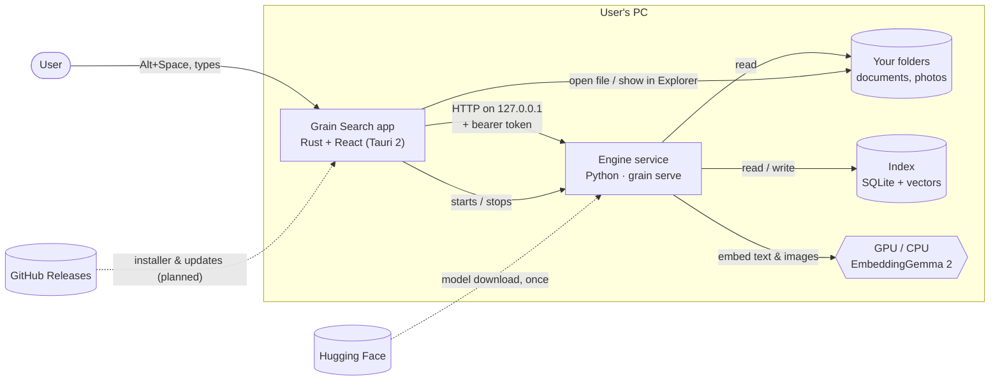
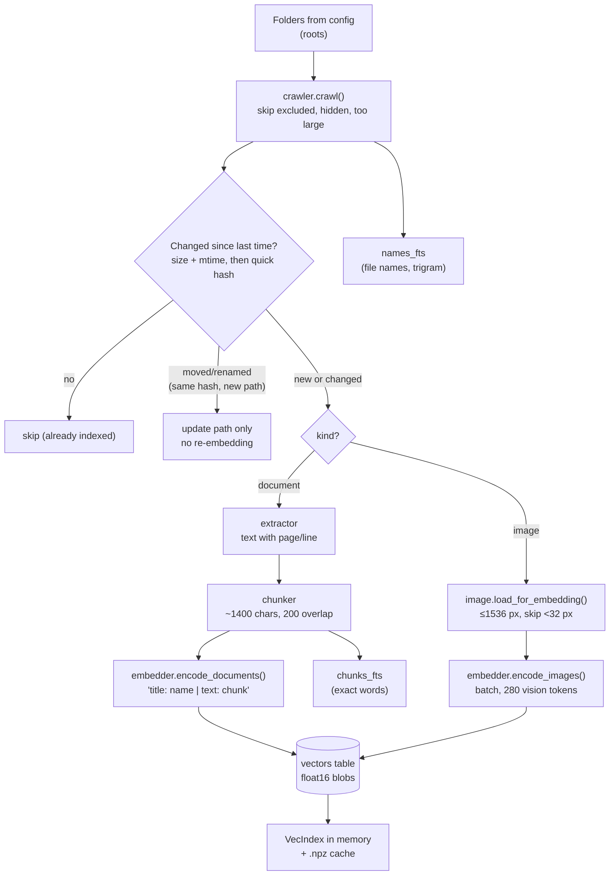
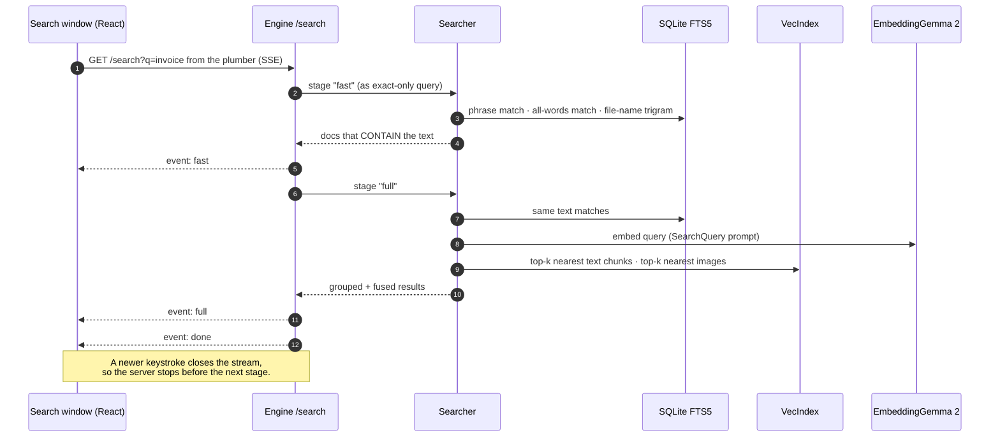
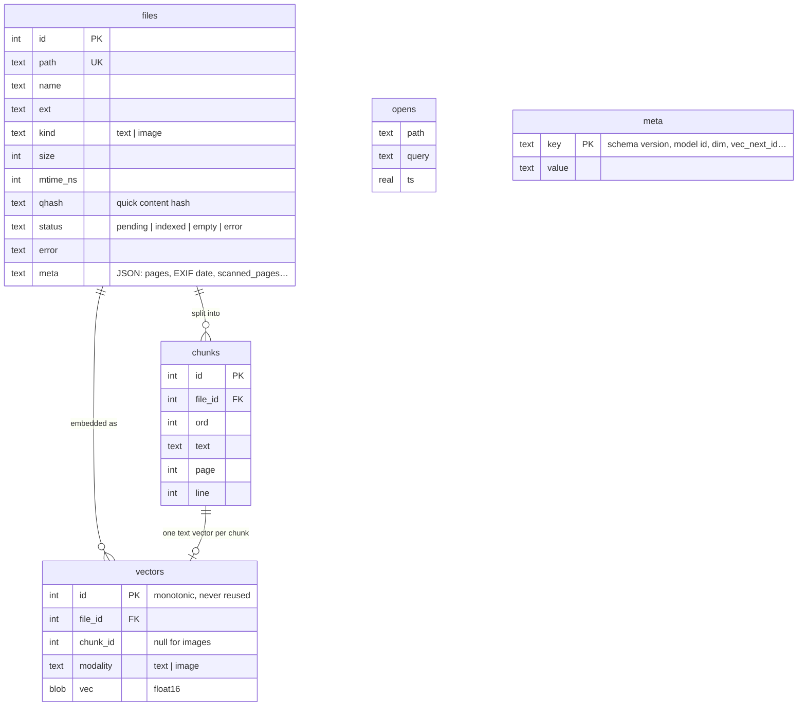
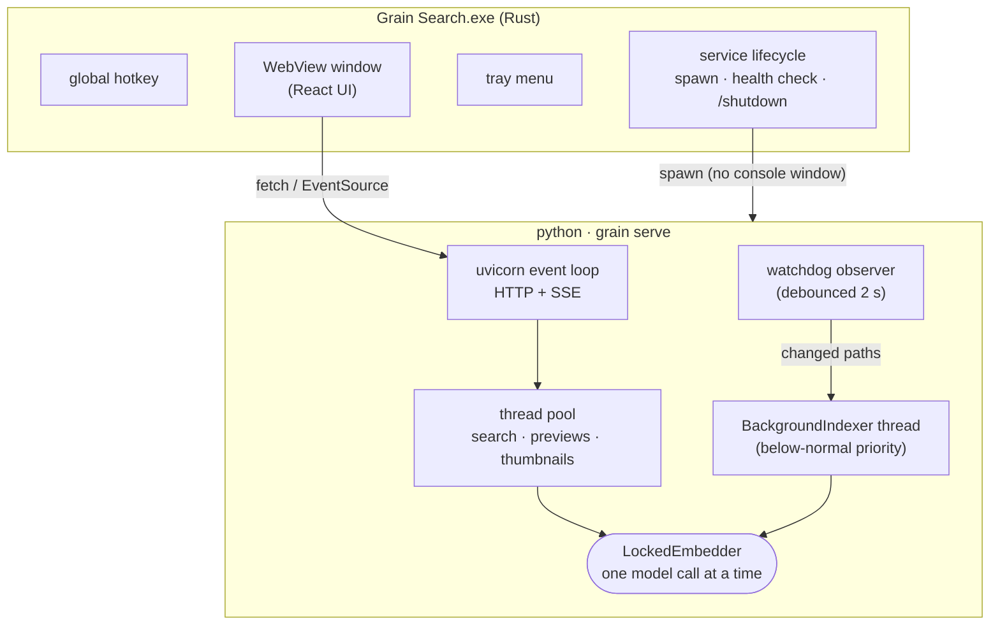
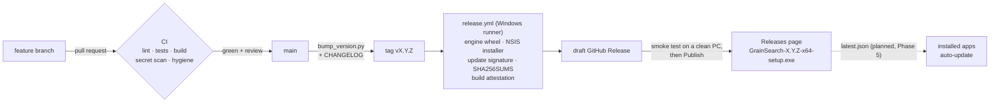
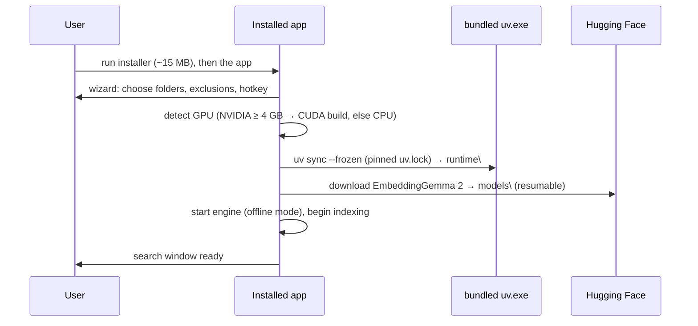

# Architecture

How Grain Search is put together: the parts, how they talk, where data lives, and why it is
built this way. Diagrams render on GitHub (Mermaid).

> **Status key:** **Now** = in the code today (v0.1). **Planned** = on the [roadmap](roadmap.md),
> with the phase that delivers it.

---

## 1. The big picture

Grain Search is two programs on the user's PC that talk over a private local connection:

- **The app** (`app/`): a small Windows program written in Rust (Tauri 2) with a React UI. It owns
  the hotkey, the search window, the tray icon and the lifecycle of the engine.
- **The engine** (`engine/`): a Python service that reads files, runs the EmbeddingGemma 2 model,
  keeps the index and answers searches.

Nothing runs in the cloud. The only network use is the one-time model download from Hugging Face
(and, planned, the update check against GitHub Releases).



### Why two processes?

| Decision | Reason |
|---|---|
| ML in **Python** | EmbeddingGemma 2 ships for PyTorch / sentence-transformers. That is the only stack where its multimodal (text + image) encoders are supported today. |
| Shell in **Rust/Tauri** | Small (~10 MB) native app with a global hotkey, tray and transparent window, using the system WebView. Electron would be ~150 MB. |
| **Local HTTP** between them | Simple, debuggable with `curl`, streams results (Server-Sent Events), and the UI can be developed in a normal browser against a running engine. |
| Engine as a **long-running service** | Loading the model takes seconds and ~1.4 GB of GPU memory. Keeping it warm makes each search take milliseconds. The same process watches files and indexes in the background. |

A Python-free engine (ONNX/LiteRT in Rust) is on the "later" list once the model's multimodal
export is proven; the HTTP boundary means the app would not change.

---

## 2. Repository map

```
engine/src/grain_search/
├─ cli.py            `grain` command: index, search, open, status, reset, serve, interactive
├─ paths.py          the app folders (%APPDATA% / %LOCALAPPDATA% / GRAIN_SEARCH_HOME); mirrored in lib.rs
├─ config.py         Config/ModelCfg dataclasses, config.json load/save, default exclusions
├─ crawler.py        walks folders, applies exclusions/hidden/size rules, quick content hash
├─ extractors/       text.py · pdf.py (PyMuPDF → pypdf fallback) · office.py (docx/pptx/xlsx) · image.py
├─ chunker.py        splits text into ~350-token overlapping chunks, keeps page/line positions
├─ embedder.py       GemmaEmbedder (all model-card rules live here) + HashEmbedder (tests)
├─ indexer.py        run_index (full pass) and index_paths (live changes); errors vs model failures
├─ store.py          SQLite schema, FTS5 tables, VecIndex (in-memory vector search)
├─ search.py         query parsing, hybrid ranking, "contains text" vs "related" grouping
├─ ranking.py        learns from what you open (local `opens` table)
├─ previews.py       highlighted excerpts, thumbnails, PDF page images
├─ service.py        HTTP API, BackgroundIndexer thread, file watcher, auth, shutdown
├─ opener.py         opens a file at the right page/line (SumatraPDF, VS Code) or in Explorer
└─ winstate.py       Windows: on battery? full-screen app? lower thread priority

app/
├─ src/              React UI: App.tsx (search bar), Settings.tsx (Settings window), api.ts (HTTP/SSE
│                    client), platform.ts (Tauri vs browser)
└─ src-tauri/src/lib.rs   hotkey, window placement, tray, autostart, start/stop the engine
```

---

## 3. Indexing: from a file on disk to searchable vectors



**Key behaviour (Now):**
- **Incremental.** A file is re-processed only if size/mtime changed *and* its quick hash differs.
  A move or rename is detected by the hash and costs no model time.
- **Errors are not model failures.** An unreadable file is marked `error` with a reason and
  skipped. If the *model* fails (e.g. GPU out of memory), indexing stops with `ModelError` instead of
  marking thousands of good files as broken. The service then waits and retries.
- **GPU-friendly.**
  - The model is capped at 50% of GPU memory (`gpu_memory_fraction`).
  - Batches halve on out-of-memory, down to 1.
  - Reserved memory is released above 2 GB.
  - Texts longer than 1024 tokens are truncated.
- **Polite.**
  - The indexer thread runs at below-normal priority.
  - It pauses on battery and while a full-screen app or game runs.
  - Commits happen before every pause, so other writers are never blocked.

### Model rules (all in `embedder.py`)
| Rule | Why |
|---|---|
| Queries use the `SearchQuery` prompt; documents use `title: … \| text: …`; images use no prefix | EmbeddingGemma 2 is trained with these task prompts; mixing them lowers quality |
| bfloat16 on GPU, float32 on CPU, **never float16** | float16 produces NaNs / garbage with this model |
| Text + vision encoders only (`audio_config=None`) | saves memory; audio is not used |
| `truncate_dim` (768 default) + normalised vectors | Matryoshka embeddings: smaller dims stay usable; a dot product equals cosine similarity |

---

## 4. Searching: hybrid ranking in two stages

Each keystroke opens a Server-Sent Events stream. The engine answers **twice**:
1. **fast**: file names and exact text, no model call. Arrives in a few ms.
2. **full**: adds meaning (vector) results and photos. Needs one model call for the query.



### How results are ranked (`search.py`)
- **Signals**, fused with Reciprocal Rank Fusion (score += weight / (60 + rank)):
  - exact phrase ×3;
  - all words ×1.5;
  - meaning ×1;
  - file name ×1.
- **Two honest groups:**
  - *Contains your text*: the words are really in the file (exact > words > name).
  - *Related by meaning*: only vector similarity.
    - Shown only above `text_min_score` (0.30).
    - When real text matches exist, at most 3 are shown, within 0.08 of the best one.
- **Photos** are a separate list, ranked by text→image similarity above `image_min_score` (0.20).
  Text and image scores are not comparable, so they are never mixed into one list.
- **Learning from you** (`ranking.py`): files you open rise within their group, with a 30-day
  half-life. A file opened for the same query before becomes the top hit. This is stored locally.
- **Query syntax:**
  - `=text` exact only; `~idea` meaning only; `"phrase"`;
  - filters `type:img|doc`, `ext:pdf,docx`, `in:D:\folder`, `after:` / `before:` (dates).

Vector search is brute-force dot products over float32 blocks in memory (`VecIndex`). That takes a
few ms for hundreds of thousands of vectors, needs no extra index structure, and is exact. Deletes
only flip an `alive` flag, and blocks are merged when enough has changed.

---

## 5. Data model



Plus two FTS5 virtual tables: `chunks_fts` (chunk text, `unicode61` with diacritics removed) and
`names_fts` (file name + path, `trigram`, for "budg 2025"-style partial names).

The database records which **model and dimension** built it. Opening it with a different one is
refused ("run `grain reset`"), because vectors from different models can't be compared.

---

## 6. Runtime: processes and threads



- **One model, shared safely.** Search and indexing both go through `LockedEmbedder`, so a query
  never fights the indexer for GPU memory. Searches are short and take the lock between batches.
- **Database access.** SQLite in WAL mode. The search side and the indexer each use their own
  connection, and the indexer commits before it pauses.
- **Startup handshake.** The engine writes `service.json` (URL, token, PID). The app reads it,
  checks `/health`, and starts the engine if needed (timeout 180 s, for the first model load).
- **Shutdown.** Tray → Quit calls `POST /shutdown`. `GracefulServer` exits cleanly and removes
  `service.json`.
  - **Gap (Now):** if the app is killed, the engine keeps running.
  - **Planned (Phase 1):** a Windows Job Object ties the engine's life to the app's.
  - **Planned (Phase 1):** the model unloads after N idle minutes.

---

## 7. Security and privacy

| Threat | Protection (Now) |
|---|---|
| Other machines on the network | Engine binds to `127.0.0.1` only |
| Other local programs / web pages calling the API | Random per-session bearer token (header, or `?token=` for `` tags); CORS allows only the Tauri origins; `/health` is the only open route |
| Reading arbitrary files through the API | `/preview`, `/thumb`, `/page`, `/open` serve **only paths already in the index** |
| Data leaving the PC | No telemetry, no accounts. File contents, queries and the index never leave the machine |
| Personal data in the public repo | `.gitignore`, `scripts/check_repo.py` (pre-commit + CI), gitleaks, GitHub secret scanning |

**Planned:**
- Signed auto-updates: the app refuses update files not signed with the project key (Phase 5).
- Code-signed installer (Phase 5).
- Build-provenance attestations on every release asset (in the release workflow now).

Report vulnerabilities privately: [SECURITY.md](../SECURITY.md).

---

## 8. Where things live on disk

| What | Now | Planned (installed app) |
|---|---|---|
| App binary | `app/src-tauri/target/…` (development build) | `%LOCALAPPDATA%\Programs\Grain Search\` (Phase 4) |
| Search settings (folders, exclusions…) | `%APPDATA%\GrainSearch\config.json`, edited live in the Settings window | same |
| Window settings (hotkey, look) | `%APPDATA%\GrainSearch\settings.json` | merged into config.json (Settings window) |
| Index, vectors, thumbnails | `%LOCALAPPDATA%\GrainSearch\index\` (`index_dir` in config.json moves it) | same, "Move index" button |
| Logs | `%LOCALAPPDATA%\GrainSearch\logs\service.log` | same, rotated |
| Service handshake | `%LOCALAPPDATA%\GrainSearch\service.json` | same |
| Python + PyTorch | `engine/.venv` (uv, development) | `%LOCALAPPDATA%\GrainSearch\runtime\` (Phase 4) |
| Model weights | Hugging Face cache | `%LOCALAPPDATA%\GrainSearch\models\` (Phase 4) |
| Port | chosen by the OS at start, written to `service.json` | same |
| Engine folder | found at run time: `engine` next to the app or in a folder above it (development: `<repo>\engine`); `engine_dir` / `GRAIN_SEARCH_ENGINE_DIR` override | bundled runtime (Phase 4) |

`paths.py` (engine) and `resolve_app_dirs` (app) apply the same rules and are tested against the
same cases. `GRAIN_SEARCH_HOME=<folder>` puts everything in one folder (portable or test profile).
On Linux/macOS the XDG folders are used (`~/.config/grain-search`, `~/.local/share/grain-search`).

None of these folders is inside the repository. Any `config.yaml`, `config.json`, `settings.json`,
index or `data/` folder is still git-ignored and blocked by CI, because they hold personal paths
and text from the user's own files.

---

## 9. Build, release and update pipeline



Details: [releasing.md](releasing.md). One version number is shared by `pyproject.toml`,
`package.json`, `Cargo.toml` and `tauri.conf.json`; CI fails if they differ or don't match the tag.

### First run of the installed app (Planned, Phase 4)


---

## 10. Testing strategy

| Layer | How | Where |
|---|---|---|
| Engine logic | `pytest` with `HashEmbedder`, a deterministic fake that needs no model or GPU. It builds real PDFs, Word, PowerPoint and Excel files in a temp folder | `engine/tests/`, CI on Linux + Windows |
| Model contract | A fake SentenceTransformer checks prompts, dtype, truncation, OOM halving | `test_embedder_contract.py` |
| Service | A real uvicorn server on a free port: auth, SSE stages, previews, path safety, watcher, pause/resume, GPU-full retry | `test_service.py` |
| Rust shell | Unit tests for settings, app folders (same cases as `test_config.py`), the service file and the tiny HTTP client | `app/src-tauri/src/lib.rs`, CI on Windows |
| UI smoothness | **Planned (Phase 3):** Playwright test measuring layout shift (CLS < 0.02) | `app/tests/` |
| Real model quality | Golden queries on your own files, run by hand | `engine/scripts/eval_golden.py` |

Tests must not depend on the machine: on Windows they force "plugged in, nothing full-screen"
and set their own exclusions, since the temp folder lives under `AppData`.

---

## 11. Known limitations

Tracked in [tech-debt.md](tech-debt.md) and GitHub issues:

- The engine can be orphaned if the app is killed (fixed by the Phase 1 Job Object).
- The model stays on the GPU while idle (Phase 1 idle unload).
- Images are indexed after all documents on the first run.
- Scanned PDF pages without text are detected but not yet searchable.
- AMD/Intel GPUs fall back to the CPU (DirectML later).
